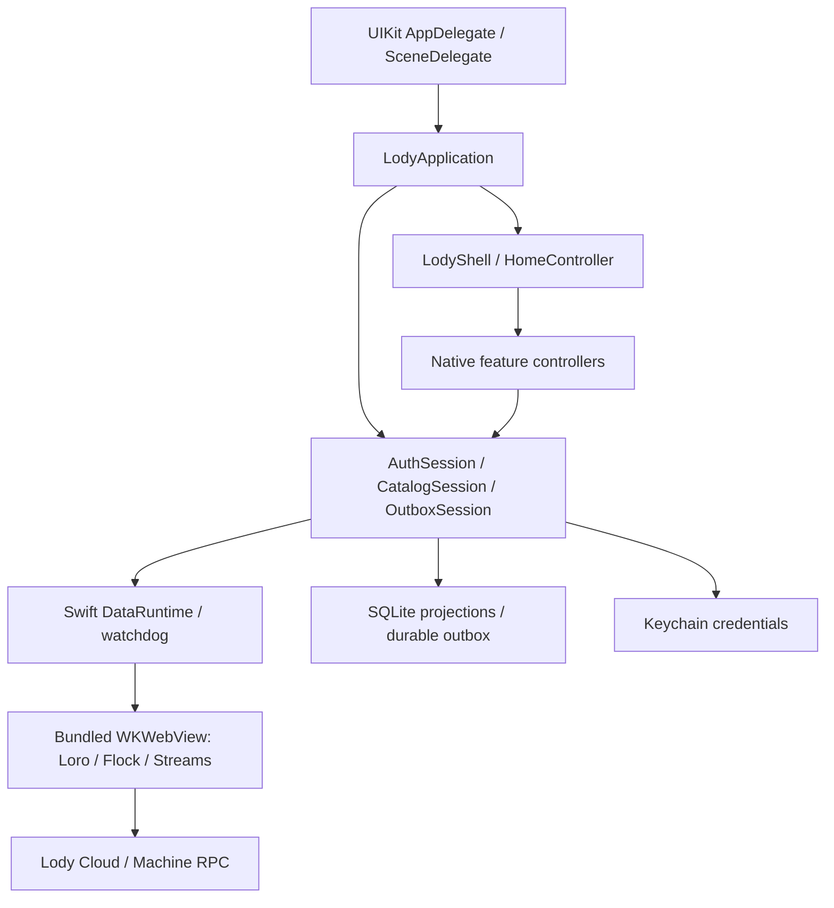

<div align="center">
  
  <h1>Lody iOS</h1>
  <p><b>Independent iOS Native Client</b> · AI Collaboration & Session Companion for Mobile</p>

  <p>
    
    
    
    
  </p>

  <p>
    <a href="https://testflight.apple.com/join/1rR6Ku8f">
      
    </a>
  </p>
</div>

https://github.com/user-attachments/assets/0bc0ab48-6f12-44e9-ae13-07af9c6b780d


---

> [!IMPORTANT]
> **This is a third-party project.** Lody iOS is an independent, community-maintained client. It is not affiliated with, endorsed by, or supported by the official Lody team. Report issues in this repository, not upstream.
>
> **The project is still under development.** It iterates quickly, so APIs, sync behavior, and UI may change without notice, and builds can be unstable or break existing sessions. Evaluate the risk yourself before relying on it.

> [!IMPORTANT]
> **本项目为第三方项目。** Lody iOS 由社区独立维护，与 Lody 官方团队无关，也不代表官方立场；本项目的问题请在本仓库反馈，不要提交给上游。
>
> **项目仍在开发中。** 迭代速度较快，接口、同步行为与界面可能随时调整，版本可能不稳定甚至破坏已有会话数据，请在评估风险后使用。

---

## TestFlight Beta

Install the current build on your iPhone through TestFlight:

**<https://testflight.apple.com/join/1rR6Ku8f>**

Requires iOS 26 or later. Beta builds track `main` and update automatically; they are pre-release and may be unstable, as described above.

---

## Overview

**Lody iOS** is an independent open-source client crafted for iPhone, providing a lightweight and secure bridge between remote Lody services and local workspaces.

The application UI and native state run in Swift and UIKit. LodyKit owns navigation, screens, authentication, catalog projections and durable sends. A Swift-managed offscreen WebView runs the bundled Loro/Flock protocol engine; React Native, Expo, Hermes and Metro are no longer app dependencies.

---

## How this was built

Lody iOS started as a one-day prototype and became a usable TestFlight client in about a week, driven by coding agents under tight product constraints: iOS only, one native kit module, system UI when React Native cannot meet HIG, and an offscreen WebView for Flock/Loro because official Node/CRDT packages do not bundle in Metro.

The full first-person write-up is **[Prototype in a Day, Shipped in a Week: Building Lody iOS in Live](https://innei.in/en/posts/tech/lody-ios-prototype-to-product)**.

What that week actually looked like:

- **Constraints before features.** The first prompt named the architecture (RN template, one Kit module, no Android, Swift when RN is not enough) and left product surface to be inferred.
- **Decide, then implement.** Navigation chrome, search, iPad shell, and onboarding were argued in the open; rejected paths stayed off `main`.
- **HIG as acceptance, not taste.** Native `UIBarButtonItem`, system sheets, and semantic colors were required; RN fakes of system chrome were rejected on screenshots.
- **Verify without login.** Offline Debug scenes, leased Simulators, screenshots for visual state, and video for temporal behavior became the gate: if the verify script was right, the change shipped.
- **RN as the base, Swift where it matters.** Chat, composer, list rows, and diffs moved into LodyKit. Swift grew from a few hundred lines on day one to nearly half the UI surface by the end of the week.

---

## Features

### Authentic Apple HIG Native Experience

- **Human Interface Guidelines Compliance**: Native adoption of iOS semantic colors, automatic light and dark mode adaptation, and Dynamic Type with SF Pro and SF Mono.
- **Native Navigation**: The UIKit shell owns navigation controllers, transparent headers, and automatic scroll edge effects. Home uses an adaptive native split with session and inspector navigation. Transient flows open as native sheets through `LodyShell.presentNative`, and system grouped rows use UIKit `UICollectionViewListCell` via `LodyGroupedList`.
- **Bilingual by Default**: English and Simplified Chinese product copy lives in `packages/LodyData/Sources/LodyData/Resources/Localizable.xcstrings`. Swift uses `String(localized:)`, Xcode compiles the catalog, and CI checks translation coverage and format arguments. Permission prompts live in `apps/ios/App/InfoPlist.xcstrings`.

### High-Performance Native Streaming Chat

- **Virtualized Chat Collection**: The chat view is backed by native Swift `UICollectionView`, maintaining full 60/120 fps smoothness even with extensive message histories.
- **CoreText Markdown Rendering**: Deeply integrated with [MarkdownView](https://github.com/Lakr233/MarkdownView) and [Litext](https://github.com/Lakr233/Litext), natively supporting complex tables, syntax-highlighted code blocks, task lists, LaTeX math formulas, and system text selection handles.
- **Smooth Character Fade-In**: Balanced batch scheduling paired with low-level `CTRunDraw` character alpha transitions delivers gentle, flicker-free streaming output during AI generation.
- **Native Input (`ChatComposerView`)**: Pixel-perfect keyboard avoidance matching system input methods, local draft persistence with automatic restoration, and real-time model thinking effort controls.

### Code Diffs & Workspace File Browsing

- **Turn Changes Overview**: Automatically summarizes file changes for each conversation turn, with one-tap access to all modified files.
- **Word-Level Diff Highlighting**: File, workspace and tool-detail diffs render natively in LodyKit.
- **Remote Workspace File Tree**: Browse project directories and files on remote Macs or servers at any time, with previews via native code view `LodyCodeView` or system Quick Look.

**Agent Conversation Sync** in Settings lists supported local projects and agents on your own computers. Refresh their history, select conversations to import, and explicitly confirm any conflict replacement. Imports run in batches and retain partial progress; this is a manual history import, not automatic device-to-device mirroring.

### Live Preview & Simulator Streaming

- **Preview Chip**: When an agent reports a local dev server, a chip above the composer opens it through the machine's Lody Quick Tunnel. Long-press copies the share link, opens it in Safari, or stops sharing. The control proof is signed natively with the Keychain credential; only short-lived tunnel links reach the app.
- **Native Simulator Viewer**: A [baguette](https://github.com/tddworks/baguette) server behind the tunnel opens a pushed native page. Native WebRTC DataChannels carry H.264/MJPEG frames, touches and hardware controls, with automatic WebSocket fallback for older CLI versions or failed connections. H.264 decodes into `AVSampleBufferDisplayLayer`; the device frame and side buttons are drawn natively. Quick Tunnel is still required for signaling and artwork. Hardware actions (Home, lock, rotate, shake, volume, screenshot) sit in the navigation bar.

### Offscreen WASM CRDT Data Sync Engine

- **Seamless CRDT Collaboration**: Executes official Loro / Flock CRDT incremental sync cores and Streams clients in a Swift-managed offscreen `WKWebView`, using the browser-safe protocol runtime.
- **Watchdog Protection**: Native Swift probing keeps background execution resilient, supporting graceful hot recovery if an anomaly occurs.
- **Multi-Session Background Sync**: Local SQLite display projections ensure millisecond cold starts, while background synchronization maintains real-time bi-directional updates for active sessions.

### Security First & Hardware Isolation

- **Standard Device Flow Auth**: Authorizes via the official Better Auth Device Flow.
- **System Keychain Storage**: All authentication credentials and sensitive communication keys are strictly isolated in the iOS Keychain and never exposed in app-accessible shared storage.

---

## Architecture



## Directory Structure

The Xcode navigator includes app sources, extensions, runtime inputs, scripts and
verification files. `Shared Extension Sources` groups the LodyKit files compiled
by extensions; their single source of truth remains the local Swift package.
Generated runtime assets and build configuration live under `.generated`.

```text
apps/ios/Lody.xcodeproj              # Generated Xcode project
apps/ios/project.yml                # XcodeGen: app, extensions and verify hosts
apps/ios/App/                       # UIKit entry, plist, entitlements and app assets
apps/ios/App/Resources/             # Images, file icons and dependency notices
apps/ios/Extensions/                # Share, notification service and Live Activity
apps/ios/.generated/                # Generated plist, XcodeGen input and runtime assets
apps/ios/runtime/decoder/           # Browser-safe decoding adapter
apps/ios/scripts/                   # Asset generation and source checks
apps/ios/verification/kit/          # Native behavior checks
apps/ios/verification/ui/           # Offline UI verification
apps/ios/tests/                     # Protocol and tooling Node tests
packages/LodyKit/Package.swift      # LodyKit library, dependencies and Metal resources
packages/LodyKit/Sources/LodyKit/    # UIKit UI, native state and coordinators
packages/LodyData/Sources/LodyData/Resources/ # Native String Catalog
packages/LodyKit/DataChannel/        # Pinned native transport build
packages/cloud-runtime/              # Bundled browser-safe protocol and contract
packages/lody-core/                  # Swift wire types and routing policies
packages/chat-kit/                   # Native chat core
packages/lexical-swift/              # Native editor
```

---

## Development & Build

### Prerequisites

- **macOS**: Sequoia or later — GitHub iOS verification and TestFlight use the macOS 27 preview image
- **Xcode**: 26.5 or later with Command Line Tools — local offline Simulator baselines default to iOS 26.5; GitHub iOS jobs use the Xcode 27 preview image and iOS 27.0
- **Node.js**: Node 22 LTS, version 22.13 or later
- **pnpm**: `11.10.0` (`corepack enable`)
- **XcodeGen**: `brew install xcodegen`
- **CMake**: `brew install cmake` for the pinned native data channel library

### Getting Started

1. **Clone the repository and install JavaScript dependencies**:

   ```sh
   git clone https://github.com/Innei/lody-ios.git
   cd lody-ios
   pnpm install
   ```

2. **Generate the native project and open Xcode**:

   ```sh
   pnpm ios
   ```

   `pnpm ios` builds bundled protocol assets and the native data channel library,
   then generates `apps/ios/Lody.xcodeproj` with XcodeGen. Xcode resolves
   Swift packages directly. Select a simulator and Run. `pnpm start` opens the
   existing project. App, extensions and offline verification hosts come from
   `project.yml`; rerun `pnpm prebuild` after changing those sources.
   LodyKit is a local Swift package in `packages/LodyKit`; SwiftPM discovers its
   sources automatically and bundles its Metal shaders.

3. **Update native assets**:

   After editing `packages/cloud-runtime` or `apps/ios/runtime/decoder`, run:

   ```sh
   pnpm bundle
   ```

### Quality Checks & Testing

```sh
pnpm check            # TypeScript, locale catalogs, generated license notices, Prettier
pnpm test             # Protocol tests and Simulator tooling tests
pnpm bundle           # Build bundled WebView protocol assets and native catalogs
pnpm licenses:build   # Regenerate the in-app notices after dependency changes
```

### Offline UI Verification

UI baselines run without login, user credentials, cloud access, or a connected machine: the runner launches with `--ui-verify` and injects deterministic native data at the Auth/Catalog boundary, and every case starts from the development-only Debug page.

```sh
pnpm verify:simulator --name '<current verify>' -- <command>   # Lease a Lody * Verify Simulator
pnpm verify:native                                             # Swift behavior checks
pnpm verify:ui --app /absolute/path/to/Lody.app                # Offline UI baselines
pnpm verify:ui --suite core --app /absolute/path/to/Lody.app  # PR core paths, Release app
```

The runner captures screenshots for visual states and video for temporal behavior; missing scenes and timeouts fail the run. See [`apps/ios/verification/ui/README.md`](apps/ios/verification/ui/README.md) for the case inventory and Simulator leasing rules.

### Releases

Pushing to `main` or dispatching `.github/workflows/ship.yml` archives a TestFlight build through `.github/workflows/release.yml`, after regenerating native runtime assets. The app has no OTA updates. Join the beta at <https://testflight.apple.com/join/1rR6Ku8f>.

---

## License

Lody iOS is released under the [GNU Affero General Public License v3.0](LICENSE) (**AGPL-3.0-only**). You may use, modify, and distribute it, including commercially, provided that derivative works and network-served modifications stay under the same license and their source stays available to users.

Bundled third-party libraries and assets keep their own licenses. The full list and license texts are available in the app under **Settings → Open Source Licenses**. The notices are generated from the production dependency closure by `pnpm licenses:build` and verified in CI by `pnpm check`.

---

## Acknowledgements

Lody iOS is made possible thanks to these open-source projects and creators:

- **[FlowDown](https://github.com/Lakr233/FlowDown)**: Thanks to [Lakr233](https://github.com/Lakr233) and contributors. Lody's native message collection view, stream batching mechanism, and dynamic measurement cache architecture drew significant inspiration from FlowDown.
- **[unixzii](https://github.com/unixzii)**: Original author of Litext, the CoreText rich-text engine underneath MarkdownView and Lody's native chat rendering. Also a generous teacher — a great deal of this project's iOS knowledge came from him.
- **[MarkdownView](https://github.com/Lakr233/MarkdownView) & [Litext](https://github.com/Lakr233/Litext)**: High-performance, extensible CoreText Markdown rendering and typography for iOS.
- **[Loro](https://github.com/loro-dev/loro)**: High-performance, production-grade next-generation CRDT state synchronization.
- **[AXe](https://github.com/cameroncooke/AXe)**: Simulator UI automation driving the offline UI baselines.
- **[baguette](https://github.com/tddworks/baguette)**: Headless iOS Simulator control and streaming (Apache-2.0). The native simulator viewer is a client of its HTTP and WebSocket protocol; baguette itself runs on the Mac and is not bundled.
- **[libdatachannel](https://github.com/paullouisageneau/libdatachannel)**: Native data-only Simulator transport (MPL-2.0), built from pinned source at `pnpm prebuild` with media and WebSocket disabled, over [libjuice](https://github.com/paullouisageneau/libjuice) (MPL-2.0), [usrsctp](https://github.com/sctplab/usrsctp) (BSD-3-Clause) and [Mbed TLS](https://github.com/Mbed-TLS/mbedtls) (Apache-2.0). No camera, microphone or WebView is involved.
- **[vphone-client](https://github.com/datdadev/vphone-client)**: Its native remote iPhone viewer (hardware decode into `AVSampleBufferDisplayLayer`, raw UIKit touch forwarding, never dropping input behind video) shaped the design of Lody's simulator viewer.
