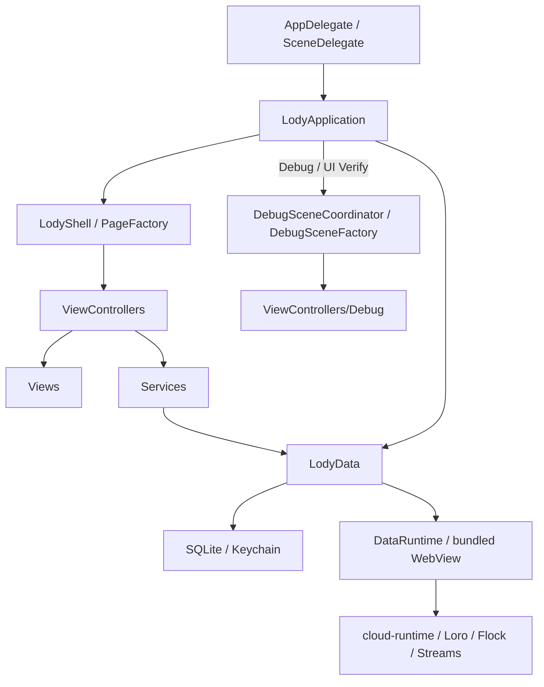
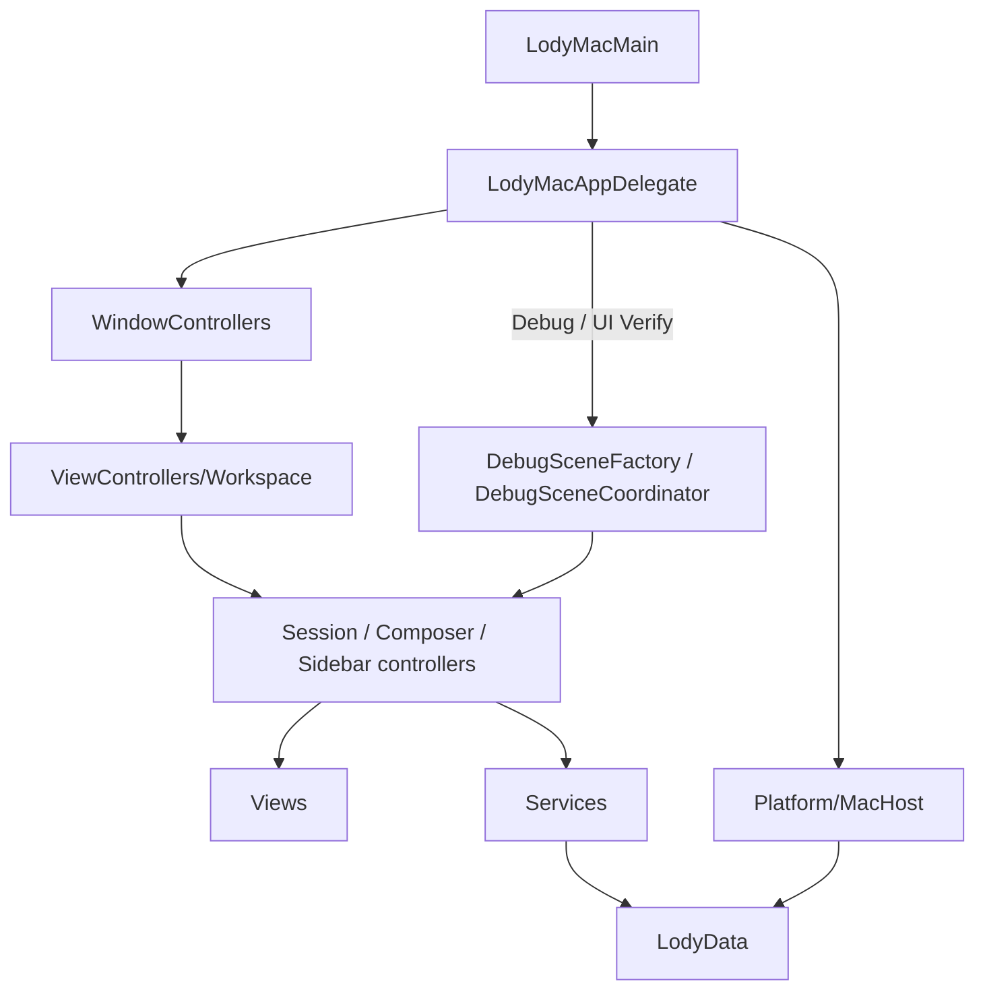

# iOS 与 macOS 工程结构

Lody 的 iOS 界面由 UIKit / SwiftUI 实现，macOS 使用 AppKit / SwiftUI。
两个平台的应用代码分别从 `iOS/` 和 `macOS/` 直接编译进对应 App target。
XcodeGen 的 `project.yml` 声明源码、资源、扩展和包依赖；`Lody.xcodeproj`
与 `.generated` 是生成结果。跨平台数据与协议能力继续由 Swift Package 提供。

## 目录与职责

| 目录                           | 职责                                                        |
| ------------------------------ | ----------------------------------------------------------- |
| `iOS/Application`              | AppDelegate、SceneDelegate、生命周期与服务组装              |
| `iOS/Navigation`               | 页面工厂、导航和呈现、折叠屏容器协调                        |
| `iOS/ViewControllers/<功能>`   | 页面、容器控制器及其扩展                                    |
| `iOS/ViewControllers/Debug`    | Debug 菜单和离线场景控制器                                  |
| `iOS/Views/<功能>`             | 视图、单元格、渲染和交互控件                                |
| `iOS/Models/<功能>`            | 展示状态、列表投影、布局与文档模型                          |
| `iOS/Services/<功能>`          | App 专用服务、读取适配器和 live 接线                        |
| `iOS/Platform`                 | UIKit Host、通知、分享收件箱和系统预览接入                  |
| `iOS/Debug`                    | Debug 场景组装、脚本服务、fixture 数据和开发视图            |
| `macOS/Application`            | 启动、生命周期、主菜单与 live 环境组装                      |
| `macOS/WindowControllers`      | 主窗口、系统窗口标签页和设置窗口构造                        |
| `macOS/ViewControllers`        | 工作区分栏、Sidebar、Session、Composer、登录与 Debug 控制器 |
| `macOS/Views`                  | AppKit 控件、SwiftUI 设置页面与样式                         |
| `macOS/Models`                 | 展示状态、设置模型、会话与 Sidebar 投影                     |
| `macOS/Services`               | 生产数据读取、写入与平台服务适配器                          |
| `macOS/Navigation`             | Session 控制器组装、流状态和标签页协调、登录窗口装饰        |
| `macOS/Platform`               | Mac Host、通知与应用文案 bundle                             |
| `macOS/Debug`                  | 离线场景工厂、fixture 与进程内验证工具                      |
| `Shared/UIKit`                 | App 与 Share Extension 共用的控制器、视图、模型和样式       |
| `Shared/ShareSupport`          | 无凭据的 App Group 快照与分享收件箱                         |
| `Shared/LiveActivity`          | App、Live Activity 扩展和验证宿主共用的活动类型             |
| `Libraries/SimulatorTransport` | 固定版本的 DataChannel 构建输入及生成的 XCFramework         |
| `packages/LodyData`            | 认证、目录、Outbox、本地存储、数据运行时与共享文案          |
| `packages/lody-core`           | Swift 协议类型、路由规则和运行时封装                        |
| `packages/cloud-runtime`       | 随应用打包的浏览器安全云协议实现                            |

共享 UIKit 的控制器同样归入 `Shared/UIKit/ViewControllers`。视图文件中的
生命周期宿主、预览控制器和表单控制器分别有自己的文件；控制器专属的普通
辅助类型可以与其实现放在一起。扩展通过 `project.yml` 选择共享源码与必要
数据类型，Share Extension 不链接认证和云运行时实现。

## 应用如何组装



`LodyApplication` 创建并连接运行时、认证、目录和 Outbox，协调登录、外部链接、
通知与分享入口。`AuthSession`、`CatalogSession`、`OutboxSession` 拥有共享状态；
页面观察投影并通过服务发起操作。平台效果经 LodyData 的 `LodyHost` 协议交给
`iOS/Platform/LodyUIKitHost.swift`，Mac 由自己的 Host 实现接入。

## 页面与 Debug 场景

`iOS/Navigation/PageFactory.swift` 注册正式页面，负责把路由参数组装成控制器。
`iOS/Debug/DebugSceneFactory.swift` 注册离线预览和验证场景。应用组装时，只在
Debug 或 UI Verify 模式安装调试场景解析器；正式页面表不包含 fixture 构造逻辑。

`DebugViewController` 负责展示调试菜单。`DebugSceneCoordinator` 负责进入场景和
选择呈现方式，fixture 数据与脚本服务放在 `Debug/Fixtures`。场景复用生产控制器，
通过服务边界提供确定性结果。

`LodyShell` 管理导航与 Sheet，`PageContainerController` 承载内容、页面结果和关闭
回调。页面沿用 `push`、`present`、`presentDetail`、`finish`、`close`，保留系统返回
按钮与交互返回。Home 的自适应分栏由 `HomeController` 协调。

外部链接由 `LodyCore.AppLink` 解析，再由 `LodyApplication` 路由。通知打开会话前
仍验证账号、工作区与目录；内部页面工厂不代替这些检查。

## 新增或修改页面

1. 将控制器及其扩展放到 `ViewControllers/<功能>`，将渲染、模型与服务分别放到
   对应目录。确实由 App 与 Share Extension 复用的实现放进 `Shared/UIKit`。
2. 在 `PageFactory` 注册正式入口；离线场景在 `DebugSceneFactory` 组装，复用正式
   控制器并注入服务。列表、表单、输入框和滚动边缘沿用已有控件。
3. 修改源码成员或扩展引用后运行 `pnpm prebuild`，通过 `project.yml` 持久化配置。
4. 运行相关行为检查和正常签名的 Simulator 构建。界面变更还需在真实 UIKit 宿主中
   验证；共享控件应覆盖 App 与扩展。

```sh
pnpm check
pnpm test
pnpm bundle
pnpm verify:native
pnpm verify:build
```

UI 检查的 Simulator 租用、英文环境、截图与录像规则见
[`verification/ui/README.md`](../verification/ui/README.md)。

## Mac 应用与验证



`LodyMacAppDelegate` 组装运行时、认证、目录、Outbox 和通知。`MacEnvironment`
提供窗口内的服务与控制器构造入口；`MainWindowController` 持有工作区，
`MacWorkspaceController` 协调分栏和当前会话。关闭最后一个窗口仍保留同步。
设置窗口承载 SwiftUI 页面，各页的 observable model 与 service 分开放置。
Mac 文案从 `macOS/Resources/Localizable.xcstrings` 随应用打包，`.lodyMac`
指向应用 bundle；跨平台数据包继续使用 `.lodyData`。

Mac 自定义控制器均放在 `ViewControllers`，包括 Debug 菜单和会话摘要预览。
`DebugSceneFactory` 只在 Debug 编译，向生产控制器注入脚本服务；fixture 实现
放在 `Debug/Fixtures`。这些代码与数据不再混入正式 service 或环境定义。

现有 Mac 行为测试位于 `verification/mac/Tests`，由 Xcode 的 `LodyMacTests`
加载实际 App 模块。测试 action 以离线、离屏参数启动宿主。`pnpm verify:mac`
执行离屏交互检查；`pnpm verify:mac:vm --in-process` 在无头 VM 中运行行为测试、
真实 XCUITest 交互和进程内检查。不要在宿主桌面运行 Mac XCUITest。
