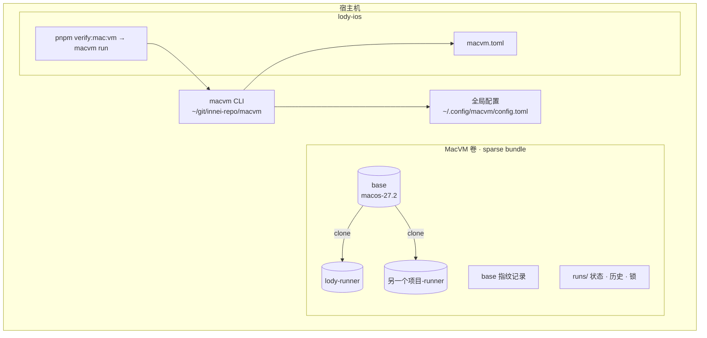

# macvm：把 macOS 验证 VM 抽成通用工具

状态：2026-11-01 已批准。原始讨论文档：https://ryugi.innei.dev/a/4QH7Qn90wpMMorr4y7G1u

## 1. 为什么做

Lody 的 `verification/mac/vm*.py` 已经能在无界面的 Tart macOS VM 里跑 XCUITest，宿主机的屏幕、鼠标和键盘全程不受打扰。但这套机制里有一半是 Lody 专属的：构建哪个工程、跑哪些用例、怎么重置 App 状态；另一半则跟项目完全无关：base VM、runner 生命周期、锁、状态面板、VNC。下一个 macOS 项目想用，就只能复制一份再改名。

目标是把跟项目无关的那一半做成独立的命令行工具 `macvm`。每个项目只提供一份配置，base VM 所有项目共用，并且会跟着宿主机环境自动更新。

## 2. 目标、非目标、反目标

| 类别 | 内容 |
| --- | --- |
| 目标 | 新项目加一份 `macvm.toml` 就能跑 VM 里的 XCUITest；base 跟项目无关，所有项目共用；每个项目有自己的常驻 runner；base 跟着宿主机 Xcode、iOS runtime 和工具清单的变化自动做增量更新；VM 里不出现需要人点的权限弹窗；XCUITest 做不到的事，AI 可以通过 `macvm` 进入 runner，用 cliclick 和 peekaboo 操作。 |
| 非目标 | 不支持 Linux 和 Intel 宿主机；不做 CI 云端调度；不管被测 App 内部的测试接缝；不同时支持多个 macOS 版本的 base（一次只有一个，系统大版本升级时整体重建）。 |
| 反目标 | 碰宿主机的屏幕、鼠标、键盘或 Dock；把项目名、bundle id 写死在工具里；VM 里出现需要人点的弹窗；只为迁移就把已经配好的 base 重装一遍；Lody 在迁移过程中有一段时间跑不了验证。 |

## 3. 约束

- Apple 虚拟化框架限制一台宿主机最多同时运行 2 台 macOS VM，更新 base 时也要占一台。
- VM 磁盘放在外接盘上的 APFS sparse bundle 里（现在是 `/Volumes/WD/lody-vm.sparsebundle`，挂载到 `/Volumes/LodyVM`）。
- base 的 SIP 必须关闭，这样才能预写权限库和启用自动化模式。在全新安装的 base 上，第一次关 SIP 仍可能要按 AGENTS.md 的说明通过 recovery VNC 手动操作。
- 不能在 VM 里构建：宿主机做 build-for-testing，VM 只做 test-without-building。
- 现有实现是纯标准库 Python。`macvm` 继续只依赖标准库，要求 Python 3.11 及以上（自带 `tomllib`）。

## 4. 整体结构



工具负责 VM 和 runner 的一切：挂载卷、装系统、关 SIP、配置 base、自动更新、clone runner、锁、VNC、状态、空闲停机、重置。项目负责告诉工具三件事：怎么构建、测什么、怎么清掉自己的状态。

## 5. 仓库和安装

- 独立仓库 `~/git/innei-repo/macvm`，一个带 `pyproject.toml` 的 Python 包，入口命令是 `macvm`。
- 安装方式：`uv tool install --editable ~/git/innei-repo/macvm`。改了工具代码马上生效，不用重装。
- 从 `verification/mac/` 搬过去的模块：`vm_guest`、`vm_base`、`vm_runner`、`vm_status`、`vm_rfb`、`vm_vnc`，以及它们的测试 `vm_test` 和 `vm_status_test`，同时去掉所有 Lody 的名字。git 历史不迁移，新仓库第一个提交注明来源的 commit。
- 全局配置 `~/.config/macvm/config.toml`：sparse bundle 路径、卷名、IPSW 地址、base 名、CPU、内存、分辨率、空闲停机时间、VNC 起始端口，以及 base 使用的宿主机 Xcode 路径（默认 `/Applications/Xcode.app`）。每项都有默认值，没有这个文件也能运行。
- 宿主机构建使用项目平时的 DerivedData，工具不传 `-derivedDataPath`，产物目录从 `-showBuildSettings` 的 `BUILD_DIR` 读取（同现在）。工具给构建命令设置 `DEVELOPER_DIR`，指向全局配置里的 Xcode，保证宿主机构建和 base 里的 Xcode 是同一个版本。需要 Xcode beta 的项目不在本期范围内。

## 6. 项目配置 `macvm.toml`

放在项目根目录。`macvm` 从当前目录往上找第一个 `macvm.toml`，也可以用 `--project <path>` 指定。下面以 Lody 为例：

```toml
name = "lody"                      # runner 叫 lody-runner；只允许小写字母、数字和连字符

[build]
command = ["xcodebuild", "-project", "Lody.xcodeproj", "-scheme", "LodyMac",
           "-configuration", "Debug", "-destination", "platform=macOS",
           "build-for-testing"]
prepare = ["pnpm", "prebuild"]     # 可选；工程文件不存在时先运行
xctestrun = "LodyMac_*.xctestrun"  # 在构建设置的 BUILD_DIR 下匹配，取最新的
products = ["Debug/Lody.app", "Debug/LodyMacUITests-Runner.app", "Debug/PackageFrameworks"]

[test]
always = ["LodyMacTests"]          # 每次都跑
suite = "LodyMacUITests"           # 不带 --case 时跑整个 target
timeout = 1800

[test.cases]                       # --case 名 → 测试类
sign-in = "SignInTests"
sidebar = "SidebarTests"
composer-new = "ComposerNewTests"
# ……其余用例照现在的 CASES 表

[reset]                            # 每次运行前在 runner 里执行
processes = ["Lody"]
process_patterns = ["[L]odyMacUITests-Runner", "[r]un/mac/run.mts"]
defaults = ["app.innei.lody.mac", "app.innei.lody.mac.uitests.xctrunner", "lody.mac.settings.catalog"]
paths = ["~/Library/Containers/app.innei.lody.mac*",
         "~/Library/Application Support/app.innei.lody.mac",
         "~/Library/Saved Application State/app.innei.lody.mac.savedState",
         "~/Library/Caches/app.innei.lody.mac",
         "~/Library/HTTPStorages/app.innei.lody.mac"]

[grants]                           # 被测 App 默认什么都不预授权；这里列出要预先给的
targets = ["app.innei.lody.mac"]  # 操控方可以向这些 App 发 AppleEvents
[grants.apps]
"app.innei.lody.mac" = []         # 例：["camera", "notifications"]；空表示每次都从"未决定"开始

[[extra]]                          # 可选的附加套件；--extra in-process 时运行
name = "in-process"
files = ["verification/mac/run.mts", "verification/mac/lib", "verification/mac/cases"]
node = true                        # 把宿主机的 node 一起拷进去
command = "~/run/node --experimental-strip-types ~/run/files/run.mts --app ~/run/Debug/Lody.app --output {out}/in-process {cases}"

[output]
dir = ".artifacts/mac-verify-vm"
```

工具始终会做的事：杀掉 `xctest` 和 `xcodebuild test-without-building` 进程，清空 `~/run`。项目只需要列出自己特有的东西。结果包统一叫 `Result.xcresult`，截图导出规则保持现状。

## 7. 命令

| 命令 | 做什么 |
| --- | --- |
| `macvm prepare [--recovery-vnc] [--repair-xcode] [--force]` | 建立或增量更新 base，规则见第 8 节。 |
| `macvm run [--case …] [--extra …] [--hold] [--fresh] [--no-update] [--output …]` | 宿主机构建，同时启动当前项目的 runner，重置后运行测试，导出结果。行为同现在的 `pnpm verify:mac:vm`。 |
| `macvm status [--follow]` | 显示 base 的状态和指纹、每台 runner 的状态、空闲倒计时、锁、正在运行的步骤，以及最近 10 次运行（带项目名）。 |
| `macvm watch` | runner 开着时，打开当前项目 runner 的 Screen Sharing。 |
| `macvm reset` | 删掉当前项目的 runner，下次重新 clone。 |
| `macvm up` | 启动当前项目的 runner 并保持开机（受空闲停机约束），不跑测试。供下面三个命令使用。 |
| `macvm exec -- <cmd…>` | 在当前项目的 runner 里通过 SSH 执行命令，返回输出和退出码，`PATH` 里已有 Homebrew。例如：`macvm exec -- cliclick c:400,300`、`macvm exec -- peekaboo see --app Lody`。 |
| `macvm screenshot [path]` | 通过 Screen Sharing 抓取 runner 的整屏截图，存成 PNG，默认存到输出目录。用的是现有的 RFB 抓帧，不依赖 VM 里的权限。 |
| `macvm migrate` | 一次性把现有的 Lody 卷和 VM 改名，见第 11 节。 |

`exec`、`screenshot` 和 `up` 都不拿锁。测试运行期间也能用 `exec`，是否会干扰测试由调用者自己判断，跟现在 VNC 的 Observe 模式是一样的约定。`up` 和 `exec` 每次调用都会刷新 runner 的活动时间，所以 AI 正在使用的 runner 不会因为"空闲最久"被别的项目挤掉。

现有参数全部保留：`run` 的 `--host-xcode`（共享宿主机 Xcode 的兜底路径）、`--timeout`、`--vnc-port`，以及 `watch --print-only`。每个 `[[extra]]` 套件除了 `--extra <name>`，也可以写成 `--<name>`，所以 Lody 的 `--in-process` 照常可用，`package.json` 的参数透传不需要改。

## 8. base 的内容和自动更新

base 的配置拆成一组有名字的步骤。每一步都有一个"指纹"，决定它需不需要重跑：

| 步骤 | 内容 | 指纹 |
| --- | --- | --- |
| system | 不睡眠、不锁屏、不建索引、自动化模式、开发者模式 | 步骤脚本的哈希 |
| xcode | 把宿主机 Xcode 拷进去，删掉其他 Xcode 副本，接受许可，执行 first launch | 宿主机 Xcode 的 build 号 |
| runtime | 导入对应的 iOS Simulator runtime，删除旧 runtime | Xcode build 号加 iOS SDK 版本 |
| screen-sharing | 启用 Screen Sharing 及其权限 | 步骤脚本的哈希 |
| services | 停掉 46 个后台服务 | 服务清单的哈希 |
| tools | Homebrew，加上 `cliclick`、`peekaboo` | 工具清单的哈希 |
| grants | 预写权限库，见第 10 节 | 操控方清单和权限清单的哈希 |
| desktop | Dock 只放 Finder、Xcode、DeviceHub、Terminal，关闭"最近使用"，纯色 Space Gray 壁纸 | 步骤脚本的哈希 |
| first-launch | 首次打开 Xcode 和 DeviceHub，提前消化首次运行的提示 | Xcode build 号 |

每一步的指纹记录在卷上的 `runs/base.json`。规则如下：

- `macvm prepare` 只重跑指纹变了的步骤；某一步变了，排在它后面并依赖它的步骤也重跑（xcode → runtime → first-launch）。全部跑完后 base 再"登录一次"让首次运行的提示消失，然后更新指纹记录和 ready 标记。
- `macvm run` 开始前先算一遍指纹。不一致就打印哪些步骤变了，先做增量 prepare 再继续；加 `--no-update` 则用旧 base 跑，并给出提示。
- base 更新后，所有 runner 在各自的下一次运行时重新 clone（沿用现在比较 ready 标记时间戳的做法）。
- 更新不在 base 本身上做，而是"先复制、成功后再替换"：prepare 先把 `macos-27.2` clone 成 `macos-27.2-next`（APFS 写时复制，几乎不占空间），所有步骤都在 next 上跑。全部成功后，用 `base.lock` 短暂锁住，把 next 改名为正式 base，再写入指纹和 ready 标记。失败时正式 base 和 ready 标记都不受影响，任何 clone（新 runner、`reset`、基础设施失败后的重新 clone、`--fresh`）拿到的始终是完整的 base。next 和它自己的指纹记录保留下来，下次 prepare 从失败的步骤继续。`base.lock` 只在 clone 和替换的那一刻持有，长时间的 Xcode 更新不会挡住别的项目。*现在的实现是一开始就删掉 ready 标记，失败后所有 runner 都跑不了，今天就遇到过一次。*
- Homebrew 工具的版本升级不算指纹变化。`macvm prepare --upgrade-tools` 会强制重跑 tools 步骤（`brew upgrade`）。

## 9. runner

- 每个项目一台，名字是 `<name>-runner`，状态放在卷上的 `runners/<name>/`：keeper、vnc.txt、状态、products、out。
- 锁分两层：`runs/base.lock` 在 prepare 时独占，clone 时短暂持有；`runners/<name>/lock` 在一次运行期间独占。不同项目的运行可以并行。
- 开机前数一下正在运行的 macOS VM。已经有 2 台时，停掉空闲最久、且锁空闲的 runner，只停机不删除；如果每台都在运行测试，就排队等。prepare 要开 base 时也走同一套规则。
- VNC 端口从 5905 起，每台 runner 各取一个空闲端口，并记录在它自己的 vnc.txt 里。
- 空闲 30 分钟自动停机、基础设施失败后重新 clone 等现有规则不变，只是改成按 runner 分别执行。

## 10. 权限弹窗

不关闭权限系统（停掉 `tccd` 的结果是全部拒绝），而是预先写入授权。SIP 关闭后，root 能写两个权限库：

- 系统级：`/Library/Application Support/com.apple.TCC/TCC.db`
- 用户级：macOS 27 搬到了 `/private/var/containers/Data/ProtectedSystem/<UUID>/Data/Library/Application Support/com.apple.TCC/TCC.db`。UUID 不固定，通过用户 `tccd` 打开的文件来定位，或者按路径模式查找。

base 的 grants 步骤给固定的操控方授予能预授权的全部权限：

- 操控方：`/usr/libexec/sshd-keygen-wrapper`、`com.apple.Terminal`、`/usr/bin/osascript`、Xcode 的 XCTest 代理，以及 Homebrew 下的 `cliclick` 和 `peekaboo`（按路径授权）。
- 权限：辅助功能、事件注入、事件监听、屏幕录制、完全磁盘访问、开发者工具、控制其他 App（AppleEvents 写到用户级库，目标包括 System Events、Finder，以及项目配置里的 bundle id）。

被测 App 默认**不**预授权，这样才能测到"未决定"和"被拒绝"两种状态。每次运行前的重置里，工具对 `[grants.apps]` 中的每个 bundle id 执行 `tccutil reset All <bundle id>`，并清掉它的通知授权，然后只写入配置里列出的权限，最后 `killall tccd` 让它重新读取。这样每次运行的初始权限状态都一样。`[grants].targets` 里的 App 会作为 AppleEvents 的目标授权给操控方。通知不在 TCC 权限库里，需要单独写入通知设置；具体做法交给实现者，验收标准是：配置里写了 `notifications` 的 App 第一次请求通知时不出现系统弹窗，并且拿到授权。

当前 base 已经给 SSH 和 Terminal 写入了辅助功能、事件注入、屏幕录制三项权限（tools 步骤），重构时这部分并入 grants 步骤。

## 11. 从 Lody 迁移

1. **建仓库，搬代码**：在 `~/git/innei-repo/macvm` 搬入模块和测试，把 Lody 的名字和路径都换成读配置，测试全部通过。
2. **一次性改名：macvm migrate（和下一步同一次落地）**：先停掉所有 VM，再依次改名：卷 `LodyVM` → `MacVM`（`diskutil rename`），base `lody-macos-27.2` → `macos-27.2`，runner `lody-verify-runner` → `lody-runner`（`tart rename`）。`runs/` 下的历史保留，只有和最近一次成功的 prepare 实际执行过的脚本一致的步骤，才按"已完成"写入 `base.json`，其余步骤留到第一次 prepare 时补跑。这样既不会整体重跑，也不会把没真正执行过的步骤误标为完成。改名和下一步"Lody 切到 macvm"在同一个提交里落地，旧的 `vm*.py` 同时删除，这样不会出现名字已经改了、旧脚本却还在用旧名字的空窗期。sparse bundle 文件名保持不变，全局配置指向它。
3. **Lody 切到 macvm**：新增 `macvm.toml`。`package.json` 里的 `verify:mac:vm*` 改成调用 `macvm run`、`macvm status --follow` 和 `macvm watch`，参数照旧透传。删除 `verification/mac/vm*.py`，保留 `build.py`、`run.mts`、`lib`、`cases`、`Tests`、`UITests`。
4. **补上权限预授权**：实现 grants 步骤和 runner 的 bundle id 授权，跑一次 `macvm prepare`。
5. **验证**：依次运行 `pnpm verify:mac:vm --case sidebar`、完整的 `pnpm verify:mac:vm`、`--extra in-process`、`macvm exec -- cliclick p` 和 `macvm screenshot`，并确认整个过程中没有出现权限弹窗（截图检查）。
6. **更新文档**：更新 Lody 的 AGENTS.md 中"Mac client"一节，以及 `vm.py` 原来的说明；macvm 仓库写一份 README，包含新项目接入步骤和 SIP 手动关闭的说明。

## 12. 留在 Lody 的

`LodyMacUITests` 和 `LodyMacTests` 两个 target、`MacVerifyInbox`、`lodymacverify://` 路由、进程内的 `pnpm verify:mac`（`run.mts`）、`build.py`，以及用例的命名。`macvm` 对它们一无所知。

## 13. 决定一览

| 决定 | 来源 |
| --- | --- |
| base 跟项目无关，所有项目共用 | 你定的 |
| 每个项目一台常驻 runner | 你定的 |
| base 跟着 Xcode、SDK、工具的变化自动更新 | 你定的 |
| 独立的通用 CLI，放在自己的仓库 | 你定的 |
| base 内置 Homebrew 和 AI 控制工具，作为 XCUITest 做不到时的兜底 | 你定的 |
| Dock 只放 Finder、Xcode、DeviceHub、Terminal，纯色壁纸 | 你定的 |
| VM 里不出现需要人点的权限弹窗 | 你定的 |
| 项目配置用 `macvm.toml`，声明式配置加附加套件 | 你同意了推荐 |
| 按步骤指纹做增量更新，运行前自动触发，`--no-update` 跳过 | 你同意了推荐 |
| 同时最多 2 台 VM，停掉空闲最久的 runner | 你同意了推荐 |
| 改成中性名字，一次性迁移，不重装 | 你同意了推荐 |
| App 内的测试接缝留在 Lody | 你同意了推荐 |
| 用预写权限库代替关闭权限系统 | 你同意了推荐 |
| 工具名 `macvm`，仓库路径，用 `uv tool` 安装 | 我的决定 |
| cliclick 和 peekaboo 作为首批工具 | 我的决定 |
| 新增 `up`、`exec`、`screenshot` 命令，且不拿锁 | 我的决定 |
| 两层锁，不同项目的运行可以并行 | 我的决定 |
| 更新失败时保留旧的 ready 标记 | 我的决定 |
| git 历史不迁移 | 我的决定 |
| base 更新采用"先复制、成功后再替换"，失败不影响正式 base | 我的决定 |
| 沿用项目平时的 DerivedData，构建时 `DEVELOPER_DIR` 指向 base 的 Xcode | 我的决定 |
| 现有参数全部保留，附加套件可写成 `--<name>` | 我的决定 |
| `up` 和 `exec` 刷新活动时间，避免被挤掉 | 我的决定 |
| 改名和切换在同一个提交里落地 | 我的决定 |
| 被测 App 默认不预授权，每次运行前清回"未决定"，项目在 `[grants.apps]` 里写明要预先给的权限 | 你定的 |

## 14. 留给实现者

- 模块在新仓库里怎么拆分，以及函数名。
- 指纹哈希的具体输入（例如脚本文本加版本常量）。
- `status` 面板在多 runner 时的排版。
- 每项权限对应的 TCC service 名称清单，以实测能消除的弹窗为准。
- 通知授权的写入方式（验收标准见第 10 节）。

## 15. 本次讨论用到的产物

- 本文档：document `mac-verify-vm-extraction`，路径 `.ryugi/artifacts/document/mac-verify-vm-extraction/doc.xml`，[云端链接](https://ryugi.innei.dev/a/4QH7Qn90wpMMorr4y7G1u)。第 1 轮的 8 项全部定下，结论见第 13 节。
- 本次会话中已经实施在 Lody 仓库的改动（未提交）：`verification/mac/vm_base.py` 新增 desktop、tools 两个步骤，first-launch 改成打开 DeviceHub，壁纸改用 NSWorkspace 设置以避开 System Events 的授权弹窗。
