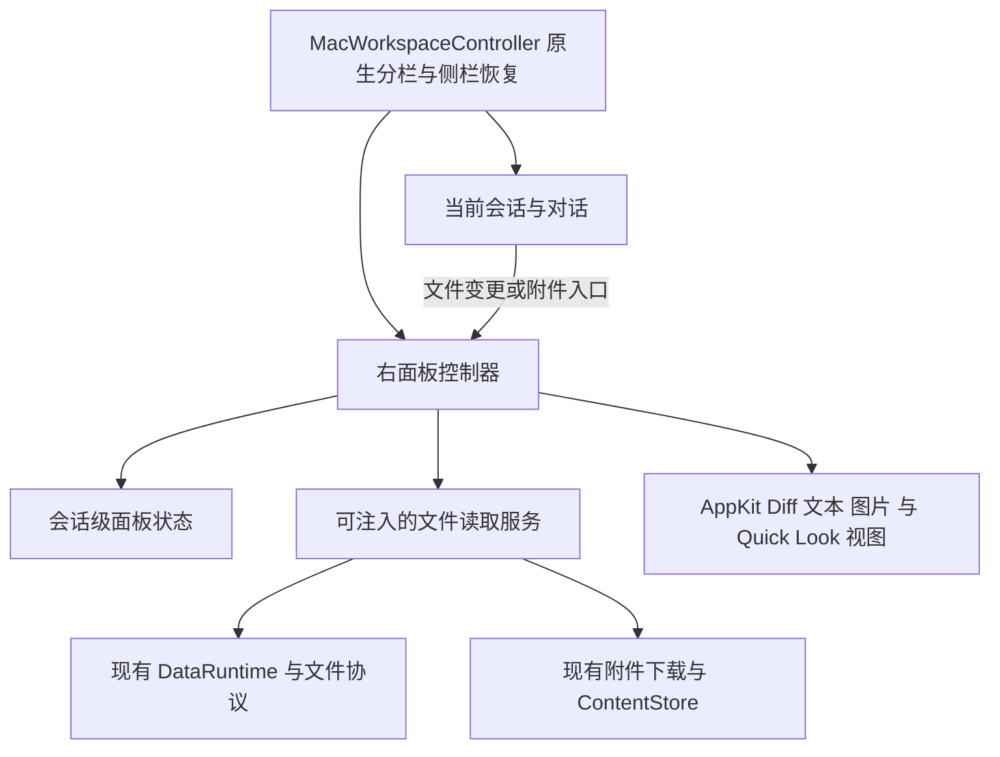

<!-- Approved by user on 2026-11-02. Source: https://ryugi.innei.dev/a/laBlqhQZYriU1hF5Dm1AD -->

# Lody Mac · Right Side Panel 设计

把 Diff、工作区文件与附件预览放进会话右侧，允许一边看对话一边核对文件。两轮外观选择已完成；本页汇总完整行为。请评论需要改的地方；确认本页后再开始原生实现。

## 已选定

| 问题     | 你的选择                                                 | 对应 Artboard    |
| -------- | -------------------------------------------------------- | ---------------- |
| 内容组织 | Changes 固定入口＋文件标签。单击临时预览，双击标签保留。 | tabs             |
| 文件导航 | 按需弹出文件树，把面板宽度留给内容。                     | navigation-popup |
| 窄窗口   | 自动收起会话侧栏，保留对话与文件；关闭右面板后恢复侧栏。 | narrow-split     |
| 标签外观 | 自绘文件标签，采用 C「收敛圆角」，选中项为独立圆角表面。 | polish-rounded   |

[打开两轮可交互 Artboard](https://ryugi.innei.dev/a/crWbKWeAn87N8BZBJ2GkC)。本地记录：artboard/mac-right-side-panel，位于 .ryugi/artifacts/artboard/mac-right-side-panel；保留两轮全部备选方案与提交记录。下文标为“我的建议”的内容是补齐实施边界，没有冒充你的既定选择。

## 打开与阅读

1. 点击对话中的文件变更汇总，打开 Changes，显示该次回复的连续 Diff；点击其中某个文件行，展开并定位到该文件。
2. 从 Diff 的预览按钮或弹出文件树打开当前文件。Changes 始终保留；文件标签在其后排列。
3. 单击新文件复用唯一的临时标签；双击文件标签将它保留。打开已有文件只激活同一标签。
4. 切换标签、关闭右面板、展开后还原，都保留当前会话的标签、Diff 折叠状态和各文件阅读位置。
5. 点击对话附件，使用同一个右面板预览。关闭面板回到对话，焦点回到发起入口。

## 布局与视觉边界

沿用 AppKit 窗口、统一工具栏、语义背景和 Lody 强调色；增删分别使用 systemGreen / systemRed。Diff 的内容层级、文件分组与代码阅读习惯尽量和 iOS 对齐。窗口上的原生标签继续表示会话，面板内部标签表示文件，两者互不替代。

2026-11-02 的 UI Polish 轮已由用户选择 `polish-rounded`：52 pt 顶栏，34 pt 标签，7 pt 圆角，13 pt 系统字体。选中标签使用语义内容底色和细边框，未选中标签保持透明、使用次级文字；临时标签保留斜体。关闭按钮始终预留位置，只在选中、悬停或键盘聚焦时显示，避免标题跳动。Changes 固定，文件区横向滚动；窄面板中的单个标签不能宽于文件区，切换及缩窄后仍须完整露出选中标签与关闭按钮。窗口前后导航保持一组，侧栏按钮独立，组间使用固定间距，不随侧栏开关伸缩。

宽窗口保留会话侧栏、对话、右面板；空间不足时先自动收起会话侧栏。只恢复系统为了打开右面板而收起的侧栏，用户原本手动隐藏的侧栏保持其选择。主动打开侧栏但三栏放不下时，收起右面板并显示侧栏。

**我的建议：**右面板宽窗口默认 640 pt，1100 pt 窗口默认 620 pt；可拖动调整。对话最小 420 pt。右面板在现有 760 pt 最小窗口下可缩到约 338 pt，底线 320 pt；代码横向滚动、长路径截断，仍保留对话。空间恢复后还原用户最近选择的面板宽度。工具栏变窄时把完整路径和增删汇总放入内容标题或状态栏，按钮保持可操作。

展开按钮临时让文件占满窗口内容区，保留返回右面板的入口；还原时恢复原布局与宽度。它不创建新窗口，也不改变窗口的全屏状态。首次进入会话默认面板关闭。

## Changes 与文件树

Changes 使用参考图中的连续纵向 Diff：文件头显示路径及增删数量，可折叠；文件头在内容滚动时保持可辨识，未修改行可展开。默认展示行内 Diff，保留行号、语法着色、横向滚动和复制文本。多文件先展开被点击的文件，其余折叠；汇总入口默认展开第一个文件。

**我的建议：**比较范围只有“本次回复”和“全部工作区变更”。从历史回复打开时，明确显示该回复的时间，不能把它误标为最新回复。独立打开 Changes 时选择最近一条含变更的回复；没有则显示全部工作区变更。全部变更的比较基准以服务返回值为准，不固定写 main。不提供 All repos、任意提交、分栏 Diff、编辑、暂存、回滚或行级评论。

文件按钮打开按需文件树，展开目录再加载其内容；选择文件后关闭弹层。搜索过滤已加载路径，界面明确“筛选已加载文件”，不伪装成远端全仓搜索。目录截断时显示“目录结果未完整返回”，保留重试与继续浏览子目录。附件与工作区文件分区，不能把附件伪装成项目内文件。Esc 关闭弹层并把焦点还给文件按钮。

## 预览与异常状态

代码是“当前文件 · 只读”，与按回复生成的 Diff 明确区分。文本支持选中、复制、查找和换行；图片默认适应面板，支持 100% / 200% 与双向滚动。PDF、音视频及其他系统支持的附件使用内嵌 Quick Look；不支持内嵌的格式保留元数据与“用快速查看打开”。

| 状态                  | 用户看到的结果                                                             |
| --------------------- | -------------------------------------------------------------------------- |
| 加载中                | 保持目标文件名与所在标签，内容区显示进度。切换其他标签不受阻。             |
| 暂无变更 / 筛选无结果 | 分别显示空状态；筛选无结果提供清除筛选。                                   |
| 机器离线 / 请求失败   | 就地说明原因并提供重试；若保留旧内容，明确标记未刷新。                     |
| 文件删除 / 基准不可用 | 保留可读 Diff 一侧及文件状态；当前文件不存在时不给出空白编辑器。           |
| 二进制 / 内容过大     | 显示文件类型和原因，不渲染成文本 Diff；已取得的本地附件可交给 Quick Look。 |

**我的建议：**Diff 和文件内容首次需要时加载，首次进入会话不预读整棵目录。提供刷新，保留旧内容直到刷新完成；助手生成期间不反复重置滚动位置。异步结果绑定账户、工作区、会话和目标，请求过期后不得覆盖另一个标签或会话。

## 实现边界

MacWorkspaceController 负责原生 NSSplitView 的侧栏、对话和右面板布局；面板控制器负责标签与当前内容；独立模型保存面板状态。MacSessionController 只发出带 sessionId、entryId、path 或附件标识的查看意图，不负责窗口宽度。装配继续从 MacEnvironment / SessionControllerFactory 注入，不增加全局展示管理器。

给实现者：数据、状态和复用边界

- 服务使用已有 TurnDiff、FileDiff、WorkspaceChanges、ReadFile、ListDir。按回复的文件列表来自该 entry 的 fileDiffs；工作区列表来自 WorkspaceChanges。保留真实 entryId，文件路径不凭 basename 匹配。
- 每个请求在发出及返回时都校验当前 DataRuntime 实例、userId、workspace 和 sessionId；面板另校验标签与加载代次。未激活的会话不主动切换全局 runtime，也不新建第二份 runtime；显示等待会话就绪，等既有激活流程完成后读取。
- 正文不进入面板状态或 UserDefaults；文件通过现有 readFile / ContentStore 的 handle 取得。Diff 可以通过类型化 perform 读取后进入有界内容缓存。缓存失效时重新加载目标，不能把失效 handle 当成空内容。附件沿用 MacMediaProvider 的真实下载入口，临时 URL 由预览生命周期持有并按既有所有权清理。
- 当前窗口按账户、工作区、会话保存轻量面板状态：是否打开、当前标签、保留标签顺序、唯一临时标签、比较范围与 entryId、各范围的折叠与滚动状态、各文件的滚动和换行选项。切换会话立刻取消旧加载并移除旧可见内容；回到原会话可恢复上述轻量状态，正文按需取回。退出登录或工作区变化清空其状态；重启不恢复文件标签。面板宽度可作为全局偏好保存。
- 工作区文件标签的身份包含当前 scope 和完整路径；附件身份使用其来源会话和 attachment id。重复打开只激活；临时预览替换不影响保留标签。关闭当前文件后激活左邻文件，没有则回到 Changes；Changes 不可关闭。标签过多时文件区横向滚动，Changes 与面板动作仍可到达。
- iOS 的 InlineDiffModel 只依赖 Foundation，可移入 LodyData 共享纯计算与行为测试；UIKit 的 InlineDiffRenderer / DiffDocumentView 留在 iOS。Mac 使用 AppKit 渲染，不引入 WebView、JS 代码编辑器或 UIKit 桥接。具体控制器命名、TextKit/collection 选择、缓存策略和安全渲染上限由实现者决定并验证。
- 加载展开的 Diff 文件，折叠项不预取正文；限制并发，长文件按需生成可见行。刷新失败保留上一份内容与未刷新标记。增删数量未知时省略，不填 0。部分文件失败只影响该文件，其他 Diff 继续可读。
- 文本内查找使用 Cmd-F、可见查找条和上一个/下一个匹配；Esc 关闭当前查找条或弹层，不拦截会话的其他命令。关闭、保留标签与文件按钮都有可访问名称和原生菜单动作；关闭面板恢复仍存在的发起控件或对话焦点。完整路径通过标题或辅助信息可读。
- Mac 字符串写入 macOS/Resources/Localizable.xcstrings；共享纯逻辑保持 Foundation 边界。源文件输入由 project.yml / Package.swift 管理，运行 pnpm prebuild，生成 Xcode 工程不手改。

已核对的代码：macOS/ViewControllers/Workspace/MacWorkspaceController.swift；macOS/WindowControllers/MainWindowController.swift；macOS/ViewControllers/Session/MacSessionController+QuickLook.swift；iOS/Services/Files/Diff/FileDiffService.swift；iOS/Models/Files/Diff/InlineDiffModel.swift；packages/cloud-runtime/src/contract/files.ts；packages/LodyData/Sources/Cloud/DataRuntime+Content.swift。

## 实施顺序与验收

这是一个中等规模的原生功能项目，按下面四个可验证阶段推进。先完成承载和状态，再接 Diff，最后接文件预览与完整验证；不把原型 HTML 搬进生产 App。

| 顺序 | 交付                                                         | 主要验收                                                                                                 |
| ---- | ------------------------------------------------------------ | -------------------------------------------------------------------------------------------------------- |
| 1    | 原生右面板、标签模型、拖动与展开、自动侧栏恢复，接离线场景。 | 临时替换、双击保留、重复打开、关闭当前标签；1100 pt / 760 pt；手动和自动收起区分；宽度与阅读位置恢复。   |
| 2    | 从对话变更入口进入连续 Diff，接本次回复与全部变更。          | 历史 entryId 正确；真实基准；展开未修改行；空、缺失、二进制、过大和部分失败；滚动到最后一个文件。        |
| 3    | 按需文件树、当前文本/图片及附件预览。                        | 惰性加载、目录截断、筛选清除、图片缩放与滚动、文本查找、Quick Look、关闭重开；下载或读取失败可重试。     |
| 4    | 多会话、异步竞态、键盘与浅深色收尾。                         | 旧请求晚到不串会话；缓存失效能恢复；原生会话标签独立；焦点返回；不抢输入框焦点；长路径和大量文件可操作。 |

每阶段用生产控制器和可注入服务建立独立、可复位的 Debug 场景，行为测试覆盖真实状态转移与竞态，不写常量表快照。日常跑 pnpm verify:mac；最终跑 pnpm mac:build 与 pnpm verify:mac:vm，至少覆盖 Diff、文件预览、布局恢复、离线重试的真实操作及 light/dark 截图。原生 UI 只在离屏入口或无头 VM 验证，不使用宿主机屏幕、鼠标或键盘。

涉及共享模型时补跑 pnpm check、pnpm bundle、相关 Swift 行为测试与 iOS simulator build；验证 iOS Diff 未回归。最终把原生截图与交互录像放回本 Artboard 的 Verify 页，按已选方案逐项核对。

## 请核对我补充的几项

- 760 pt 最小窗口继续保留对话，允许右面板比原型的 440 pt 下限更窄。
- 比较范围明确为本次回复 / 全部工作区变更，历史回复显示真实时间。
- 首版只读，包含文本、图片与系统附件预览；不做编辑、Git 写操作、行级评论或任意提交比较。
- 同窗口内可恢复会话的轻量面板状态，应用重启后不恢复文件标签。
